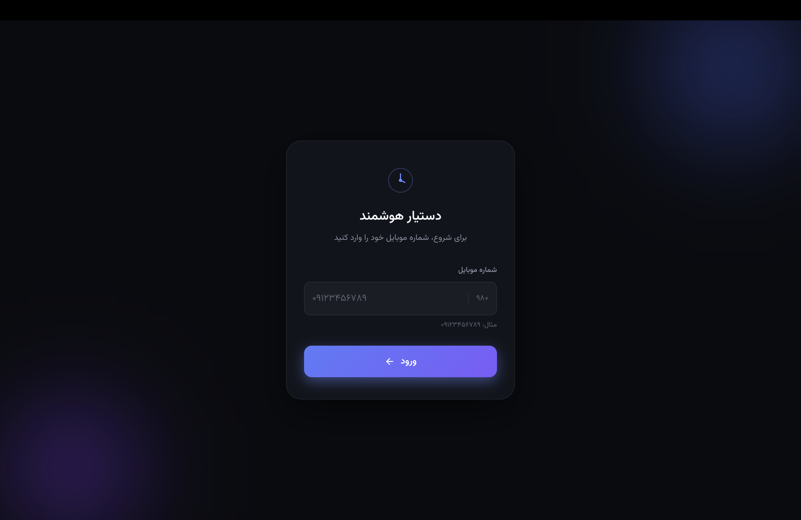
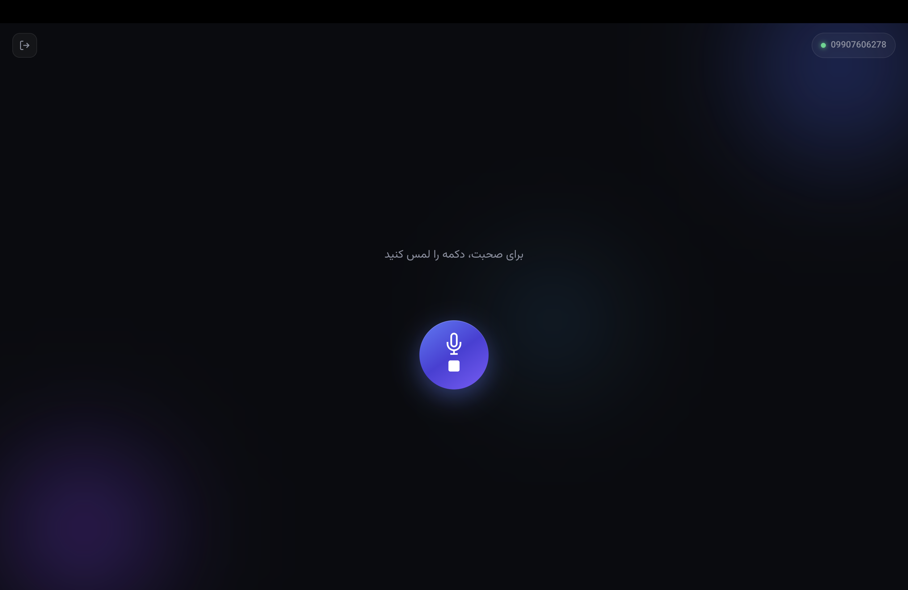

# ClinicSpeak

ClinicSpeak is a voice assistant for clinics. A patient opens the page, presses a button, asks a question out loud in Persian, and gets an answer back as both text and speech. There is no typing and no menu to navigate, just a conversation.

Clinics tend to get the same kinds of questions over and over, and answering them usually means someone has to pick up the phone. I wanted to build something that could handle that conversation naturally, using the clinic's own information rather than a model's guesses.

I built the whole thing in Node.js, from the WebSocket server to the database layer to the browser client.


## Screenshots

| Login | Home |
|-------|------|
|  |  |

## How it works

1. **Listening.** The browser streams microphone audio to the server over a WebSocket, and the server forwards it to a speech-to-text service that returns Persian text in real time.
2. **Knowing when you're done.** People pause in the middle of sentences, so a silence alone isn't a reliable signal. After a few seconds of quiet, the server scores the transcript to decide whether it is a complete thought or whether the user is probably still talking. If it's not complete, it keeps listening.
3. **Finding the right information.** The question is turned into an embedding and matched against the clinic's documents stored in the database. If there is earlier context in the conversation, it is used to improve the search for follow-up questions.
4. **Answering.** The most relevant documents are passed to a language model with strict instructions to answer only from that material. If nothing relevant is found, the assistant says it doesn't have enough information instead of inventing an answer.
5. **Speaking back.** The reply is converted to Persian speech and sent to the browser over the same WebSocket. The microphone stays closed while the assistant is talking and reopens when the audio finishes, so it never ends up listening to itself.

Every session and message is saved, so conversations keep their context from one turn to the next.


## Features

- **Voice-only interaction.** The user talks and the assistant talks back, with the reply also shown as text on screen.
- **Smart turn detection.** The server scores each transcript to decide whether the user has really finished speaking, so a short pause doesn't cut anyone off.
- **Answers grounded in clinic data.** Responses come from the clinic's own documents using retrieval-augmented generation (RAG), not from the model's general knowledge.
- **Context-aware follow-ups.** The previous message is taken into account when searching, so short follow-up questions still find the right information.
- **Honest fallback.** When no relevant information is found, the assistant says so instead of guessing.
- **Phone number login.** Users identify themselves with their phone number, and each user gets their own conversation history.
- **Persistent storage.** Sessions, conversations, messages and clinic documents are stored in MySQL.

## Tech Stack

| Layer | Technology |
|-------|------------|
| Runtime | Node.js |
| Web framework | Express 5 |
| Real-time communication | WebSocket (`ws`) |
| Database | MySQL with Sequelize |
| Speech-to-text | iotype |
| Language model and embeddings | OpenRouter |
| Text-to-speech | FreeTTS |
| Frontend | EJS templates and vanilla JavaScript |


## Getting Started

### Prerequisites

- Node.js 18 or higher
- MySQL
- API keys for [OpenRouter](https://openrouter.ai), [FreeTTS](https://freetts.org) and iotype

### Installation

```bash
git clone https://github.com/benyamin-haghighy/ClinicSpeak.git
cd ClinicSpeak
npm install
```

**1. Create the database**

```sql
CREATE DATABASE `clinic-speak`;
```

The app connects to MySQL on `localhost:3306` as `root` with an empty password. If your setup is different, update the credentials in `src/config/db.js` and `src/config/config.json`.

**2. Add your environment variables**

```bash
cp src/.env.example src/.env
```

Then open `src/.env` and fill in the values:

| Variable | Description |
|----------|-------------|
| `PORT` | Port for the web server |
| `OPENROUTER_API_KEY` | Used for the language model and for embeddings |
| `FREE_TTS_API_KEY` | Used for text-to-speech |
| `IO_TYPE_TOKEN` | Used for real-time speech-to-text |

**3. Run the migrations**

```bash
npm run db:migrate
```

**4. Load the clinic documents**

```bash
node src/saveChunk/chunckDocumnets.js
```

This embeds the documents in `src/saveChunk/chunckDocumnets.js` and stores them in the database. To use your own clinic's information, edit the list in that file before running it. Run it once, since running it again will add the same documents twice.

**5. Start the app**

```bash
npm run dev
```

Open `http://localhost:PORT/login` in your browser (replace `PORT` with the value from your `.env`), enter a phone number and allow microphone access when the browser asks.

The WebSocket server runs on port `8080`, so make sure that port is free.


## Project Structure

```
ClinicSpeak/
├── docs/screenshots/        Screenshots used in this README
└── src/
    ├── app.js               Express app and the WebSocket call flow
    ├── server.js            Entry point
    ├── config/              Database configuration
    ├── migrations/          Sequelize migrations
    ├── models/              Sequelize models
    ├── service/
    │   ├── ask_ai/          Answer generation
    │   ├── embedding/       Text embeddings
    │   ├── tts/             Text-to-speech
    │   └── ws/              WebSocket server and speech-to-text connection
    ├── validation/          Turn completion scoring
    ├── saveChunk/           Embeds and stores the clinic documents
    ├── utils/               Database helpers and vector search
    ├── views/               EJS templates (login and home)
    └── public/              Browser JavaScript and CSS
```

## Current Limitations

- Login identifies users by phone number only, with no verification step.
- The assistant understands and answers in Persian only.
- The WebSocket server port (`8080`) is fixed in the code.
- Document search compares the question against every stored document, which works well for a clinic's knowledge base but isn't built for very large collections.

## License

This project is licensed under the MIT License. See the [LICENSE](LICENSE) file for details.